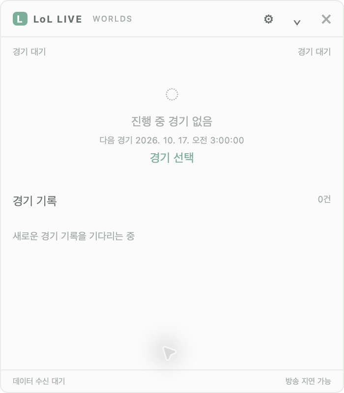
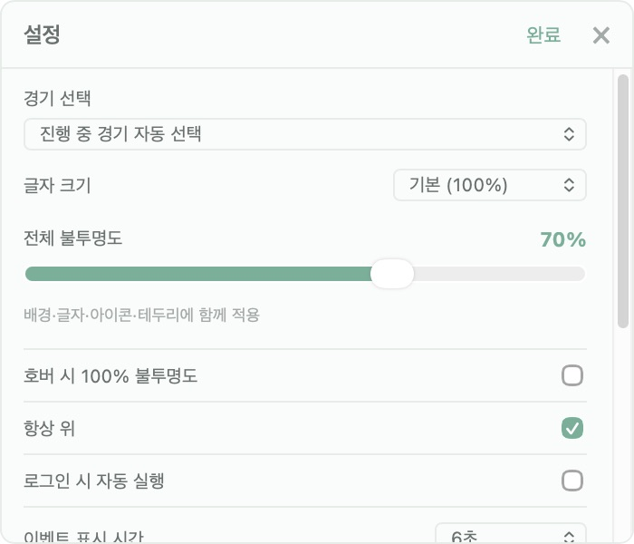

<div align="center">

# LoL Live Widget

**경기를 놓치지 않는 작은 스코어보드**

다른 작업을 하는 동안에도 LoL e스포츠 스코어와 최근 경기 기록을 화면 위에서 확인하세요.


[다운로드](#다운로드) · [시작하기](#시작하기) · [화면 미리보기](#화면-미리보기) · [개발하기](#개발하기) · [검증 현황](#검증-현황)

</div>

## 다운로드

**설치 도구나 API 키 없이 파일을 받아 바로 실행하세요.**

[](https://github.com/BapSangE/lol_live_widget/releases/latest/download/LoL-Live-Widget.exe)
[](https://github.com/BapSangE/lol_live_widget/releases/latest/download/LoL-Live-Widget-macOS-arm64.dmg)

[최신 릴리스·변경 내용·SHA-256 확인 →](https://github.com/BapSangE/lol_live_widget/releases/latest)

Windows는 EXE를 더블 클릭하고, Mac은 DMG 안의 앱을 Applications로 복사해 실행하세요. macOS **Intel은 지원하지 않습니다.** 소스 코드 ZIP은 개발자용이며, 일반 사용자는 위 두 파일 중 자신의 OS에 맞는 파일을 받으면 됩니다.

## 화면 미리보기

작게 접어 두고, 필요한 순간 클릭해 경기 기록을 펼칩니다.

<p align="center">
  
</p>

<table>
  <tr>
    <th>확장 화면</th>
    <th>설정 화면</th>
  </tr>
  <tr>
    <td valign="top"></td>
    <td valign="top"></td>
  </tr>
</table>

*v0.1.0 macOS 앱에서 직접 촬영한 라이트 테마 화면입니다. 촬영 당시 진행 중인 경기가 없어 대기 상태를 표시합니다. 설정 화면은 스크롤 영역의 상단입니다.*

## 주요 기능

| 기능 | 동작 |
| --- | --- |
| 작은 스코어보드 | 최소화 상태에서도 스코어와 최신 경기 기록 한 줄 표시 |
| 펼쳐 보는 경기 기록 | 같은 가로 폭으로 확장하며 일반적인 기록 두 건을 볼 공간 확보 |
| 응원 팀 알림 | 설정에서 팀 선택 → 다음 일정 확인 → 라이브 확인 시 무음 팝업과 해당 경기 자동 전환 |
| 글자 크기 조절 | 기본 **100%** · 크게 **120%** · 아주 크게 **140%**, 재실행 후에도 유지 |
| 화면 위에 고정 | 항상 위, 드래그 이동, 전체 불투명도와 호버 불투명도 설정 |
| 조용한 이벤트 알림 | 중요한 사건을 기본 6초 동안 표시하며 무음으로 동작 |
| 간편한 실행 | 앱에 수집기 포함, 별도 Python·Node.js·서버·API 키 설치 불필요 |

기본 폭은 모든 모드 **350px**입니다. 100% 기준 최소화/확장/설정 높이는 62/400/300px이며, 글자를 키우면 창 높이와 줄 높이도 함께 늘어납니다. 작은 화면에서는 높이를 제한하고 내부 스크롤을 사용합니다.

## 시작하기

| 플랫폼 | 전달할 파일 | 실행 방법 |
| --- | --- | --- |
| Windows 10/11 x64 | `LoL-Live-Widget.exe` | 파일 하나를 복사해 더블 클릭 |
| macOS Apple Silicon | `LoL-Live-Widget-macOS-arm64.dmg` | DMG를 열고 앱을 Applications로 옮겨 실행 |

### Windows

1. [Windows 실행 파일](https://github.com/BapSangE/lol_live_widget/releases/latest/download/LoL-Live-Widget.exe)을 받습니다.
2. **`LoL-Live-Widget.exe`를 더블 클릭**합니다. WebView2가 없으면 처음 한 번 설치 안내가 나옵니다.
3. 위젯을 클릭하면 펼쳐지고, **Esc**로 접습니다. **X** 또는 트레이 메뉴의 **종료**로 앱과 수집기를 함께 종료합니다.

로컬 빌드 산출물은 `dist/LoL-Live-Widget.exe`입니다. [Windows 사용·빌드 안내 →](docs/windows_portable.md)

### macOS

1. 전달받은 DMG를 열고 **LoL Live Widget.app**을 **Applications** 폴더로 옮깁니다.
2. 앱을 실행하면 위젯과 수집기가 함께 시작됩니다. 별도 런타임 설치는 필요 없습니다.
3. 확인되지 않은 개발자 경고가 뜨면 앱의 출처를 확인한 뒤 Finder의 **우클릭 → 열기**, 또는 macOS **개인정보 보호 및 보안 → 확인 없이 열기** 안내를 따릅니다.

[macOS DMG 다운로드](https://github.com/BapSangE/lol_live_widget/releases/latest/download/LoL-Live-Widget-macOS-arm64.dmg). **Apple Silicon용**이며 Intel Mac은 별도 빌드가 필요합니다. [macOS 사용·빌드 안내 →](docs/macos_portable.md)

> 인터넷 연결이 필요합니다. 기본 공급원은 **Worlds 공개 비공식 피드**이며, 진행 중인 경기가 없으면 `경기 대기`와 다음 일정을 표시합니다. 현재 배포본에는 자동 업데이트와 Developer ID 서명·공증이 포함되지 않습니다.

### 응원 팀 경기 알림

1. 위젯을 펼치고 **설정 → 응원 팀**에서 원하는 팀을 선택합니다. 현재 리그의 일정에 등장하는 팀을 선택할 수 있습니다.
2. 설정에 다음 경기 일정이 표시되며 선택한 팀은 재실행 후에도 유지됩니다.
3. 앱 실행 중 해당 팀의 경기가 라이브로 확인되면 위젯이 펼쳐지고, 15초 동안 무음 시작 알림을 표시하며 해당 경기로 자동 전환합니다. 숨겨 둔 위젯도 다시 표시합니다.

앱을 켰을 때 이미 진행 중이라면 `경기 진행 중`으로 안내합니다. 같은 경기의 세트 변경·재연결·앱 재실행 때 알림을 반복하지 않으며, 이후 다른 경기를 직접 선택할 수 있습니다. 앱 종료 중에는 알림을 보내지 않습니다. 일정·경기 상태는 공개 공급원의 갱신에 따르므로 실제 시작보다 늦을 수 있습니다. **OS 알림 센터 알림이나 소리는 사용하지 않습니다.**

### 설정과 로그

설정에서 응원 팀·글자 크기·불투명도·항상 위·자동 실행·표시 이벤트를 변경할 수 있습니다. 기본 불투명도는 65%, 자동 실행은 OFF입니다. 메뉴는 Windows 트레이 또는 macOS 메뉴 막대에서도 열 수 있습니다.

| 항목 | Windows | macOS |
| --- | --- | --- |
| 실행 로그 | `%LOCALAPPDATA%\LoLLiveWidget\portable.log` | `~/Library/Logs/LoLLiveWidget/portable.log` |
| 설정 | 앱 설정 폴더의 `settings.json` | `~/Library/Application Support/com.lollive.widget/settings.json` |

## 데이터와 검증 범위

공개 일정 페이지의 경기 JSON과 `feed.lolesports.com` 통계 피드를 읽는 **개인용 비공식 클라이언트**입니다. 기본 경로는 API 키를 읽거나 전송하지 않습니다. 공개 페이지 형식이나 접근 정책이 바뀌면 수집이 중단될 수 있습니다.

- **확인 완료:** 공개 일정·과거 경기 feed 응답, 실제 LCK 샘플 재생, Windows와 macOS에서 사용자 실행 확인.
- **추가 확인 필요:** 진행 중 경기의 연속 수신 → 스코어·기록 갱신 → 세트 전환 → 종료까지의 전체 흐름.
- 일정 캐시로 경기 발견이 늦을 수 있으며, 통계는 현재 시각보다 약 20초 전까지 조회합니다. 이 수치는 방송 대비 실측 지연이 아닙니다.
- 공급원이 제공하지 않는 값은 `null`로 처리합니다. 모의 데이터는 `DEMO`, 과거 경기 재생은 `REPLAY`로 표시합니다.

[공개 공급원 검증 기록](docs/unofficial_live_validation.md) · [LCK 실제 캡처 검증](docs/lck_2026_capture_test.md)

## 개발하기

**Tauri 2 + React + TypeScript** UI와 **FastAPI** 수집기로 구성됩니다. Node.js 22+, Python 3.12+, Rust stable이 필요합니다. Windows는 Microsoft C++ Build Tools와 WebView2, macOS는 Xcode Command Line Tools도 필요합니다.

```sh
npm --prefix apps/desktop ci
python -m venv .venv
# Windows: .venv\Scripts\activate
# macOS/Linux: source .venv/bin/activate
python -m pip install -e 'apps/server[test]'
```

이후 명령은 저장소 루트에서 가상환경을 활성화한 뒤 실행합니다. 이 작업공간의 기존 가상환경과 macOS 패키징 스크립트는 `.venv312`를 사용합니다.

| 목적 | 명령 |
| --- | --- |
| Worlds 공개 라이브 미리보기 | `python scripts/run_live.py` |
| LCK 공개 라이브 미리보기 | `python scripts/run_live.py --league lck` |
| 다운로드한 실제 LCK 샘플 재생 | `python scripts/run_lck_replay.py` |
| 서버 없는 모의 데이터 UI | `npm --prefix apps/desktop run dev` |
| Tauri 네이티브 개발 | `npm --prefix apps/desktop run tauri -- dev` |

미리보기는 [http://127.0.0.1:1420](http://127.0.0.1:1420)에서 열립니다. 공개 라이브·리플레이 런처는 수집기와 UI 개발 서버를 함께 실행하며 **Ctrl+C**로 종료합니다. 8000·1420 포트를 사용하므로 이전 실행을 먼저 종료하세요.

<details>
<summary><strong>데이터 모드와 리플레이 상세</strong></summary>

일반 개발 UI와 Tauri 기본 실행은 모의 데이터입니다. 서버 연결은 `apps/desktop/.env.local`의 `VITE_SERVER_URL=http://127.0.0.1:8000`으로 지정합니다. 공개 라이브 런처와 portable 앱은 연결 설정을 자동으로 전달합니다.

LCK 샘플은 GEN–HLE 2026-09-13 1세트의 약 69초를 원래 간격으로 재생합니다. 킬 스코어는 3:3에서 4:4로 바뀝니다. 전체 경기 녹화가 아니며 원본에 없는 게임 시계는 `--:--`로 표시합니다. 종료 후 마지막 통계와 `재생 구간 종료`를 유지하며 자동 반복하지 않습니다. 처음부터 보려면 런처를 다시 실행하세요. 재생 중에는 외부 요청이나 API 키가 필요 없습니다.

독립 라이브 서버 설정은 `SOURCE_MODE=live`, `SOURCE_APPROVED=true`, `LIVE_PROVIDER=public`, `LIVE_LEAGUES=worlds`입니다. 선택 가능한 기존 persisted 어댑터는 `LIVE_PROVIDER=persisted`와 해당 API용 `LOLESPORTS_API_KEY`가 필요하며, `RGAPI-` Riot Developer 키와는 호환되지 않습니다.

</details>

### 검사와 패키징

```sh
python -m pytest apps/server/tests
npm --prefix apps/desktop run check
npm --prefix apps/desktop test -- --run
npm --prefix apps/desktop run build
cargo test --locked --manifest-path apps/desktop/src-tauri/Cargo.toml
```

| 대상 | 빌드 명령 | 상세 안내 |
| --- | --- | --- |
| Windows x64 EXE | `python scripts/build_windows_portable.py` | [필수 의존성과 산출물](docs/windows_portable.md) |
| macOS arm64 APP + DMG | `python scripts/build_macos_portable.py` | [필수 의존성과 산출물](docs/macos_portable.md) |

패키징에는 `pyinstaller>=6.10,<7`이 추가로 필요하며, 각각 해당 OS에서 빌드합니다. Windows EXE의 `--demo`는 오프라인 UI, `--smoke-test`는 내장 서버 검사입니다.

<details>
<summary><strong>서버 운영 · NSIS · API 계약 생성</strong></summary>

별도 서버용 Windows NSIS 클라이언트는 `npm --prefix apps/desktop run tauri -- build`로 생성합니다. 서버 origin을 빌드 시 `VITE_SERVER_URL`로 지정하면 CSP에 반영됩니다. 결과는 `apps/desktop/src-tauri/target/release/bundle/nsis/`에 생성됩니다.

독립 서버는 아래 명령으로 실행합니다. 기본 데이터는 모의 데이터이며, 설정은 환경변수 또는 uvicorn `--env-file`로 전달합니다.

```sh
python -m uvicorn app.main:app --app-dir apps/server --host 127.0.0.1 --port 8000
```

메모리 저장소이므로 worker는 1개만 사용합니다. 서버 재시작 시 로그와 revision이 초기화되고 클라이언트는 새 epoch로 재동기화합니다. 외부 배포는 HTTPS reverse proxy를 사용하고 SSE 버퍼링을 끄며 idle timeout을 heartbeat 15초보다 길게 설정합니다. Docker 빌드 명령은 `docker build -f apps/server/Dockerfile -t lol-widget-server .`입니다.

API 계약을 변경했다면 함께 재생성합니다.

```sh
python scripts/export_contract.py
npm --prefix apps/desktop run generate:contracts
```

</details>

## 검증 현황

**0.2.0 · 응원 팀 팝업 알림과 경기 자동 전환 추가**

v0.1.0의 기본 실행은 두 플랫폼에서 사용자가 확인했습니다. 응원 팀 기능은 예정→라이브 전환·수신 연결 변경·중복 알림 방지를 자동 테스트로 확인했으며, 실제 라이브 실기기 확인은 남아 있습니다. 실제 라이브 경기 전체 흐름, 자동 실행 ON/OFF, 재실행 설정 유지, Windows DPI 125/150/200%, 다중 모니터, WebView2 없는 새 PC는 추가 수용 검증 대상입니다.

| 경로 | 역할 |
| --- | --- |
| `apps/desktop` | React UI와 Windows/macOS Tauri 앱 |
| `apps/server` | 데이터 공급원, 이벤트 감지, 메모리 저장소, REST/SSE |
| `scripts` | 라이브·리플레이 런처와 OS별 패키징 |
| `fixtures` | 모의 데이터와 출처를 기록한 실제 경기 샘플 |
| `docs` | 화면 이미지, 사용법, 계약, 설계와 검증 기록 |

[변경 기록](docs/progress.md) · [수용 테스트](docs/test_plan.md) · [구현 명세](docs/implementation_spec.md) · [구현 계획](docs/implementation_plan.md) · [API 계약](docs/api_contract.md)
